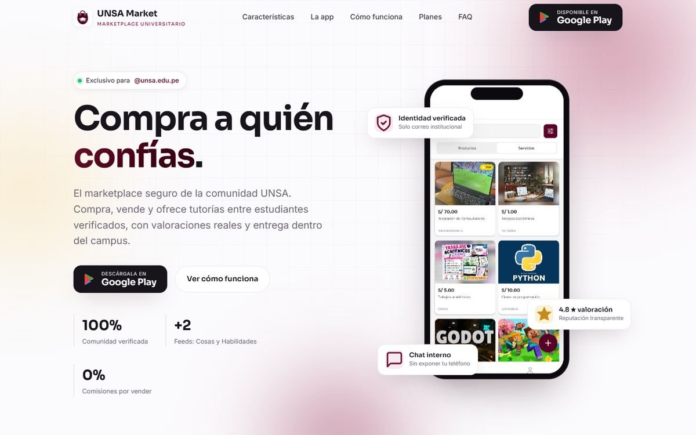
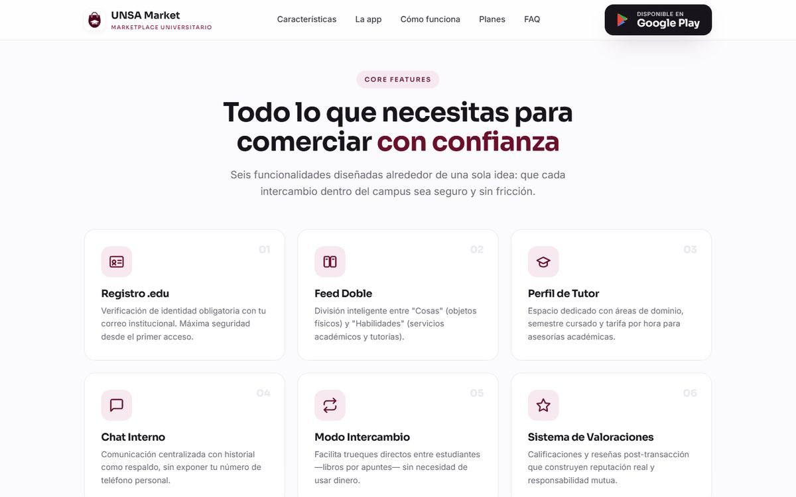

# Landing de UNSA Market

Página de presentación de [UNSA Market](https://github.com/JCuenca17/unsa-market), la app de compraventa entre estudiantes de la UNSA. Explica qué problema resuelve, muestra pantallas reales de la app y lleva a la descarga en Google Play.

Sitio: [unsamarket.vercel.app](https://unsamarket.vercel.app/)

## Secciones

Portada con el botón de descarga, características de la app en tarjetas, pantallas reales, el uso paso a paso, los planes Gratis y Pro y preguntas frecuentes.

## Cómo está hecha

HTML, CSS y JavaScript sin frameworks ni librerías. Las animaciones al hacer scroll y los contadores usan `IntersectionObserver` y `requestAnimationFrame`, y el menú se pliega en el celular. Las fuentes son Sora e Inter, de Google Fonts. Está desplegada en Vercel.

Para verla en local basta con abrir `index.html` en el navegador.
